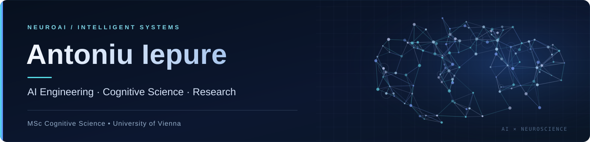

 

**Building AI systems that connect neural data, cognitive science, and reliable software.**

`NeuroAI & Neural Decoding` &nbsp; · &nbsp; `Applied Machine Learning` &nbsp; · &nbsp; `AI Systems Engineering`

 

[**Explore research ↓**](#selected-research--engineering) &nbsp;&nbsp;•&nbsp;&nbsp; [**Technical focus ↓**](#technical-focus) &nbsp;&nbsp;•&nbsp;&nbsp; [**Get in touch ↓**](#connect)

---

### About me

I'm **Antoniu Iepure**, an AI engineer and **MSc Cognitive Science student at the University of Vienna**, with a background in Artificial Intelligence at Babeș-Bolyai University.

I work at the intersection of **neural representation learning**, **mental imagery**, and **reliable AI systems**. My projects range from decoding visual information in fMRI signals to building tools for cognitive research and structured, verifiable AI workflows.

My engineering philosophy is simple: **strong baselines, careful evaluation, reproducible experiments, and honest scientific claims.**

### Selected research & engineering

<table>
<tr>
<td width="50%" valign="top">

#### [01 / IMAGINA](https://github.com/toniIepure25/Imagina)
**Human–AI tools for cognitive research**

A local-first platform for symbolic scene authoring, human-guided correction, and behavioral experiments on perception and imagination. Built with explicit provenance and scientific claim boundaries.

COGNITIVE SCIENCE · HCI · RESEARCH SOFTWARE

**[Explore project →](https://github.com/toniIepure25/Imagina)**

</td>
<td width="50%" valign="top">

#### [02 / FMRI2images](https://github.com/toniIepure25/FMRI2images)
**Neural decoding & visual representations**

Research pipelines for aligning fMRI signals with CLIP representations, retrieving visual stimuli, and exploring image reconstruction with reproducible evaluation.

fMRI · PYTORCH · REPRESENTATION LEARNING

**[Explore project →](https://github.com/toniIepure25/FMRI2images)**

</td>
</tr>
<tr>
<td width="50%" valign="top">

#### [03 / Perception vs. Imagination](https://github.com/toniIepure25/perceptionVSimagination)
**Shared and distinct neural representations**

A reproducible framework for comparing neural decoding approaches across visual perception and mental imagery, with an emphasis on baselines, data constraints, and generalization.

COMPUTATIONAL NEUROSCIENCE · BENCHMARKS

**[Explore project →](https://github.com/toniIepure25/perceptionVSimagination)**

</td>
<td width="50%" valign="top">

#### [04 / ASAR](https://github.com/toniIepure25/multi-step-agent-research)
**Structured autonomous research agents**

A research-agent prototype integrating typed planning, tool execution, evidence-aware verification, and experiment logging. The implemented v0 is intentionally scoped and auditable.

AGENTIC AI · VERIFICATION · SYSTEM DESIGN

**[Explore project →](https://github.com/toniIepure25/multi-step-agent-research)**

</td>
</tr>
</table>

### How I approach research

> **A clear question** → **a reproducible baseline** → **held-out evaluation** → **error analysis** → **an evidence-backed conclusion**

I'm especially interested in understanding **when more complex AI models actually improve scientific inference**—and when careful controls reveal that they do not.

### Technical focus

| Area | Tools & methods |
|:---|:---|
| **Machine learning** | Python, PyTorch, scikit-learn, representation learning, statistical evaluation |
| **NeuroAI** | fMRI, EEG/MEG workflows, neural decoding, cognitive modeling |
| **AI systems** | LLM workflows, structured agents, retrieval, orchestration, verification |
| **Software engineering** | TypeScript, FastAPI, React / Next.js, SQL, Docker, Git, automated testing |

### Other explorations

- **[Jane Street Kaggle Competition](https://github.com/toniIepure25/JaneStreetKaggleCompetition)** — financial time-series modeling and feature-engineering experiments.
- **[Quant AI Trading Bot](https://github.com/toniIepure25/quant-ai-trading-bot)** — experimental predictive modeling, ensemble methods, and trading simulations.

### Connect

I'm open to conversations around **NeuroAI, computational cognitive science, applied ML, and research software engineering**.

[**GitHub**](https://github.com/toniIepure25) · [**All repositories**](https://github.com/toniIepure25?tab=repositories)

---

Built around curiosity, reproducibility, and evidence—not inflated claims.

